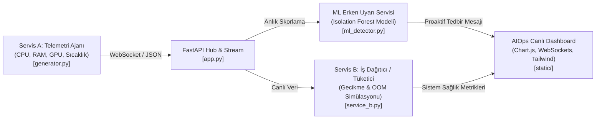

# 🚀 Outlier Stream Lab - Veri Akışı (Aykırı Değer Senaryosu)

Bu proje; iki mikroservisin birbiriyle haberleştiği, normal aralıklarda sorunsuz işleyen ancak **aykırı değerler (outliers)** ortaya çıktığında darboğazlar ve krizler yaşayan bir bulut altyapısını simüle eder. Sistem, bir **Makine Öğrenmesi (Isolation Forest)** modeli ile bu sapmaları anlık olarak tespit eder ve sistem çökmeden önce **proaktif / önleyici bildirimler** üretir.

---

## 🏗️ 1. Mimari ve Bileşenler



### Bileşen Görevleri:
1. **Servis A (`generator.py`):**
   * Bulut sunucusunun CPU, RAM, GPU, Sıcaklık ve Aktif Görev metriklerini saniyede 1 üretir.
   * Kontrollü anomali enjeksiyonlarını destekler: `NORMAL`, `MEMORY_LEAK`, `CPU_BURST`, `GPU_RUNAWAY`, `CRITICAL_CRASH`.
2. **Servis B (`service_b.py`):**
   * Sunucu kaynaklarını kullanarak görevleri işleyen tüketici servis.
   * Aykırı değerler geldiğinde gerçekçi sistem sorunlarını simüle eder:
     * CPU > %85: İşlemci kısıtlaması (Throttling), gecikme (latency) artışı, kuyruk şişmesi.
     * RAM > %80: Swap/Paging gecikmesi, bellek doygunluğu, OOM Killer çöküş riski.
     * GPU > %85: CUDA bellek aşımı, termal kısıtlama, başarısız görev patlaması.
3. **ML Erken Uyarı Servisi (`ml_detector.py`):**
   * **Algoritma:** Scikit-Learn **Isolation Forest** (100 ağaç).
   * **Neden Isolation Forest?** Aykırı değerler veride az sayıda ve normallikten yapısal olarak farklı olduğu için rastgele ağaçlarda köke çok yakın (kısa yolla) izole edilir. Etiketli arıza verisine ihtiyaç duymadan denetimsiz (unsupervised) öğrenir.
   * **Skorlama & Kök Neden (XAI):** Karar fonksiyonunu 0-%100 risk skalasına dönüştürür ve hangi metriğin normalden en çok saptığını (Z-Score) hesaplar.
   * **Proaktif Bildirim:** Sadece anomali var demek yerine krizin niteliğine göre somut eylemler önerir (ör. *Pod Tahliyesi/Drain*, *Backpressure*, *HPA AutoScale*, *Rate Limiting*).
4. **FastAPI Hub & Canlı Arayüz (`app.py`, `static/`):**
   * WebSocket üzerinden tarayıcıya milisaniyelik veri akışı sağlar.
   * Chart.js ile 30 saniyelik kayan pencere grafiği, risk göstergesi, sağlık panelleri ve canlı olay günlüğü sunar.

---

## 🧪 2. Simüle Edilen Senaryolar ve Önlemler

| Senaryo | Doğan Sorun | ML Modeli Erken Uyarısı | Proaktif Tedbir Eylemi |
|---|---|---|---|
| **Normal Akış** | Sorun yok (Gecikme ~20ms, %0 hata) | Risk <%35 (STABİL) | Müdahale gerekmiyor. |
| **Bellek Sızıntısı (RAM)** | RAM sürekli artar, OOM Killer servisi öldürür (`SIGKILL`) | Risk >%80 (OOM ÖNLEYİCİ ALARM) | Servis B yeni iş kabulünü durdurur (Backpressure), pod'lar yedek node'a tahliye edilir. |
| **CPU Ani Sıçrama** | İstek kuyruğu kilitlenir, zaman aşımı (Timeout 504) | Risk >%90 (GECİKME KORUMA ALARMI) | Kuyrukta Rate Limiting açılır, düşük öncelikli batch görevler askıya alınır. |
| **GPU Kilitlenmesi** | CUDA OOM hatası, model inferansı çöker | Risk >%90 (CUDA OOM ALARMI) | İnferans batch boyutu küçültülür, fan profili %100'e çekilir. |
| **Kritik Çöküş** | Tüm kaynaklar tükenir, zincirleme sistem arızası | Risk %100 (ACİL MÜDAHALE) | Acil Drenaj (Node Drain) ve failover protokolü başlatılır. |

---

## 🖥️ 3. Kurulum ve Çalıştırma

### Bağımlılıklar
```bash
pip install fastapi uvicorn websockets scikit-learn numpy pydantic
```

### Sunucuyu Başlatma
```bash
cd outlier_stream_lab
python3 -m uvicorn app:app --host 0.0.0.0 --port 8000 --reload
```

Tarayıcınızdan **`http://localhost:8000`** adresine giderek canlı paneli açabilirsiniz.
Panodaki butonlara tıklayarak istediğiniz senaryoyu anlık enjekte edebilir ve sistemin tepkisini izleyebilirsiniz!
